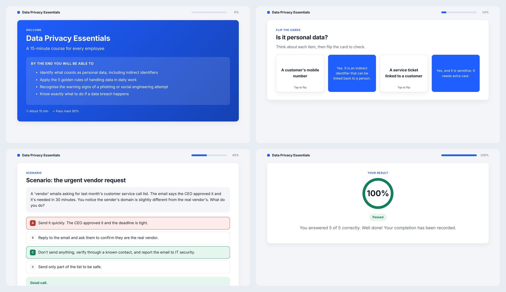
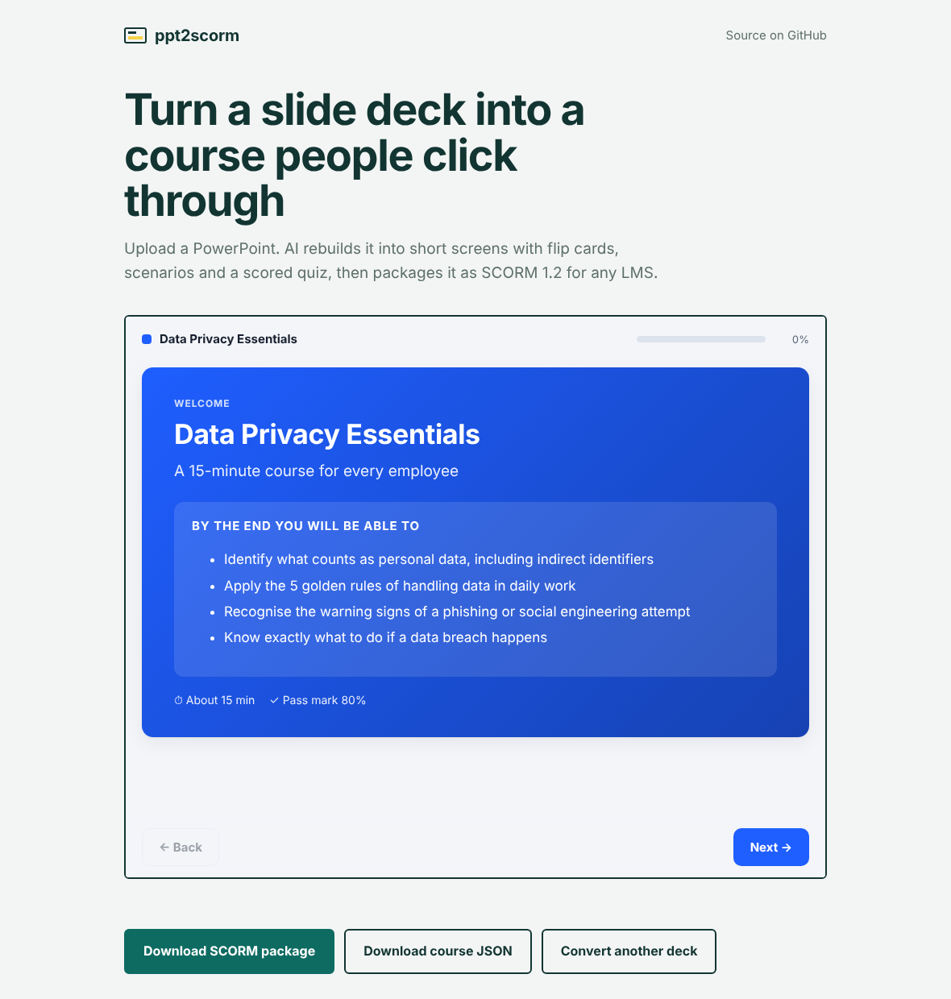
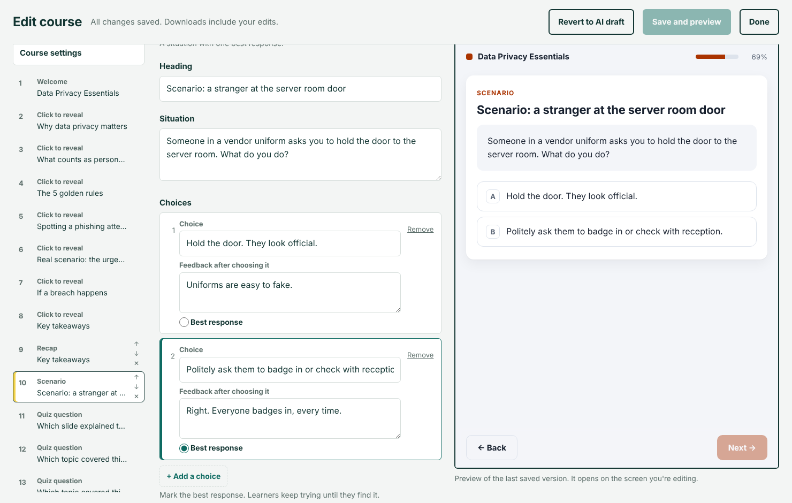
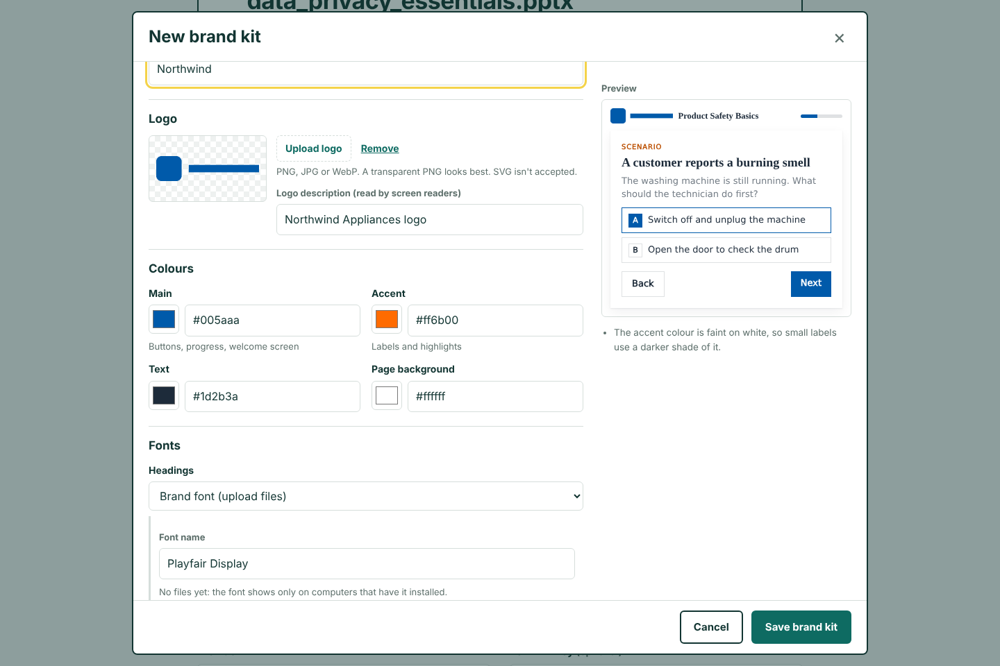
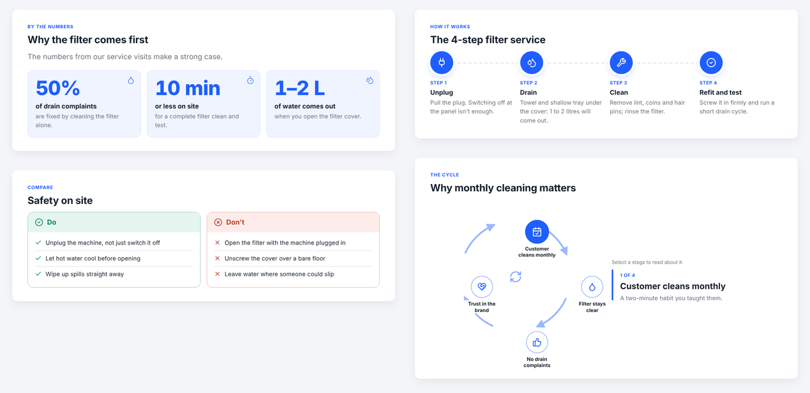

# ppt2scorm

Turn a PowerPoint deck into an **interactive SCORM 1.2 course** that can be uploaded to any LMS
(SuccessFactors Learning, Cornerstone, Moodle, Docebo, TalentLMS, etc.).

The tool doesn't just copy the slides. It uses an LLM (Gemini, Claude, GLM, Qwen or any OpenRouter model)
to **redesign** the deck the way an instructional design team would: a hook, short modules with dividers,
infographics (process, timeline, stats, do/don't comparison, cycle, pyramid, icon grid, checklist), icons on
every screen, optional stock photos, flip cards, click-to-reveal lists, sorting and matching activities,
branching scenarios, practice questions along the way and a scored final quiz.



*Generated from the sample deck in `samples/`. [Download the finished SCORM package](https://github.com/heena8feb-ctrl/ppt2scorm/releases) to try it in your LMS.*

```
PPTX ──► 1. extract ──► 2. AI redesign (LLM) ──► course.json ──► 3. player + SCORM packager ──► course.zip
                               │                     ▲
                               └── human review/edit ┘
```

## Web app

Upload a deck in the browser, watch it convert, click through the finished course, and download the SCORM zip.
No command line needed for the people using it.



### Review and edit before you download

AI drafts need a human check. After converting, click **Review and edit** to open the course editor:

- Every screen is listed in order. Move, delete or add screens: welcome, content, flip cards, click to reveal,
  matching, scenario, recap and quiz questions.
- Edit any text, pick the correct quiz answer or best scenario response, and set the pass mark, duration and brand colour.
- Problems are flagged as you type, such as a question with no correct answer, and saving is blocked until they're fixed.
- **Save and preview** rebuilds the SCORM package in about a second, and the preview opens on the screen you edited.
- **Revert to AI draft** discards every edit.



Run it on your own computer:

```bash
pip install -r requirements.txt
set GEMINI_API_KEY=your-key-here        # optional: Mac/Linux use export. Users can also paste their own key.
uvicorn web.app:app --port 8000
```

Then open http://localhost:8000. To host it for others, use the included `Dockerfile` on any host that runs
Docker containers, and set the key as a secret environment variable on that host.

| Setting (environment variable) | Default | Purpose |
|---|---|---|
| `GEMINI_API_KEY` (or another provider's key) | none | Shared key so visitors can try AI mode without their own key |
| `PPT2SCORM_DAILY_LIMIT` | `10` | AI conversions per visitor per day on the shared key |
| `PPT2SCORM_MAX_MB` | `50` | Largest upload allowed |
| `PPT2SCORM_JOB_TTL_MIN` | `120` | Minutes before uploaded decks and generated files are deleted |
| `PPT2SCORM_WORKERS` | `2` | Conversions that can run at the same time |

Keys pasted by visitors are used for that one conversion and are never stored or logged.

### Slide visuals

Photos, diagrams and charts from the deck come through into the course:

- Pictures, including ones inside groups, are extracted and resized. Logos and template art that repeat across
  slides, and tiny icons, are skipped.
- Slides whose meaning is in a **chart, SmartArt or a diagram drawn with shapes** are rendered to an image, with
  the title and empty margins trimmed off. This needs [LibreOffice](https://www.libreoffice.org/download/) installed.
  On Windows and Mac, also run `pip install pymupdf`. Without them everything else still works, and the app
  tells you which slides were skipped.
- The AI places images on the screens they belong to and writes alt text. Basic mode uses each slide's image
  on that slide's screen.
- In the course, images sit beside the text, or above a scenario or question, and learners can tap to enlarge.
  The SCORM package includes only the images the course uses.
- In the editor, every image-capable screen has an **Image** field: pick any image from the deck, upload your
  own, or edit its description.

Try it with `samples/visuals_test.pptx`, which has a photo, a chart, a shape diagram and a logo on every slide.

### Narration

Every screen can have a voice-over, with captions and play/pause controls:

- The AI writes a short spoken script for each screen: one to three sentences that add context from the
  speaker notes without giving away quiz answers. Basic mode uses the speaker notes.
- **AI voice** records each script with Google Gemini text-to-speech. Ten voices are available, and the MP3s
  add about 15 KB per screen. **Device voice** records nothing: the learner's computer reads the script aloud.
- In the course, narration starts once the learner clicks Next, as browsers allow. Learners can pause,
  replay, turn captions on and switch auto-play off. Their choices are remembered.
- In the editor, every screen has a **Narration script** field. Editing a script, or changing the voice, flags
  just those screens. **Record audio** re-records only what changed.
- If Google's voice service is busy or a free limit runs out, the course is still made. Screens without
  audio use the device voice until you record them.

Turn it on with **Narration** in the web app, or `--narrate` (AI voice) or `--device-voice` on the command line.
AI voice needs a Gemini API key. MP3 encoding uses `lameenc`, installed by `requirements.txt`, or `ffmpeg`;
without either, WAV files are used, which are about 6x larger.

### Brand kits

Courses can carry your brand: logo, colours, fonts and corner style.



- **From a website:** type the company's web address. The tool reads the home page, its stylesheets and
  icons to find the logo, the brand colours (ranked by how and where they're used, skipping warning reds and
  success greens) and the fonts. With an AI key, the AI picks the best match from what was found and can't
  invent values. Free Google Fonts used by the site are downloaded and bundled.
- **From the deck:** "Use this deck's branding" reads the PowerPoint theme colours, theme fonts and the
  logo repeated on the slides.
- **By hand, or both:** every detected value can be changed in the kit dialog, with a live preview and
  readability warnings. Upload your brand font files (WOFF2, WOFF, TTF or OTF); they're bundled inside each
  SCORM package, so nothing loads from the internet and LMS or firewall rules can't break the look.
- **Reuse and share:** kits are saved on your computer in `~/.ppt2scorm/brands` (change this with
  `PPT2SCORM_BRANDS`). They can be exported as one `.brand.json` file, with logo and fonts inside, and
  imported by a colleague. In the editor you can switch a course to another kit or save a course's
  detected branding as a kit.
- Text stays readable: if a brand colour is too light or dark for text or buttons, the course uses a
  readable shade automatically.

Command line: `--brand-from-website www.company.com`, `--brand-from-deck`, `--brand-kit company.brand.json`,
and `--save-brand-kit company.brand.json` to keep a detected kit.

Hosting for the public? Website reading only fetches public addresses, never internal servers. Brand kits are
shared by everyone using the same server, which suits a team; set `PPT2SCORM_BRAND_SAVING=0` on a public
site, and kits can still be used for one course at a time.

### Infographics, icons and photos

The AI is briefed like a senior learning designer: every screen must carry something visual, no two
neighbouring screens may look the same, and each idea gets the visual that fits its shape:

| The content is… | It becomes |
|---|---|
| steps in order | **Process** with numbered, icon badges |
| phases, dates, before/during/after | **Timeline** |
| a few key numbers | **Stats** that count up |
| right way vs wrong way | **Comparison** (green/red columns) |
| a repeating loop | **Cycle** learners click through |
| priorities or a hierarchy | **Pyramid** |
| 3–6 parallel ideas | **Icon grid** |
| things to check before acting | **Checklist** learners tick off |
| categories to tell apart | **Sort activity** (drag or tap into 2–3 groups) |

Longer courses are split into 2–4 modules with full-width **module dividers**, and short unscored practice
questions are spread through the course before the final quiz.



**Icons** come from the open-source [Lucide](https://lucide.dev) set (ISC licence, included in the package),
so they work offline in any LMS. Basic mode (no AI) also picks infographics and icons from the slide text.

**Stock photos (optional).** Choose *Photos: Stock photos* on the upload page and paste a free
[Pexels API key](https://www.pexels.com/api/) (or set `PEXELS_API_KEY` on the server). The AI suggests a
search for the moments that deserve a real photo (module dividers, scenarios, the welcome screen), and each
photo is credited to its photographer on the screen. In the editor's image picker you can search Pexels
yourself and swap any photo. On the command line, add `--photos` with `PEXELS_API_KEY` set.

In the editor you can add module dividers, infographics and sort activities, switch an infographic's layout,
edit each part (with an icon picker), and choose which group each sort item belongs in.

## Quick start (command line, Windows)

1. Install Python 3.10 or newer from python.org and tick **Add Python to PATH**.
2. Get a free Gemini API key at [aistudio.google.com](https://aistudio.google.com).
3. Download this repo (**Code → Download ZIP**, or `git clone`), open the folder, type `cmd` in the
   File Explorer address bar and press Enter.
4. Run:

```
python -m pip install -r requirements.txt
set GEMINI_API_KEY=your-key-here
python -m ppt2scorm.cli path\to\your_deck.pptx --provider gemini --draft-only
python -m ppt2scorm.cli path\to\your_deck.pptx --course-json path\to\your_deck.course.json --preview-dir preview
```

The first command writes a draft course JSON for review. The second builds `your_deck_scorm.zip` next to
your deck. Open `preview\index.html` to try the course, then upload the zip to your LMS.
On Mac or Linux, use `python3` and `export GEMINI_API_KEY=...` instead.

## Setup

```bash
pip install -r requirements.txt
```

Set **one** API key for the AI step:

| Provider | Flag | Key variable | Default model |
|---|---|---|---|
| Google Gemini (free tier in AI Studio) | `--provider gemini` | `GEMINI_API_KEY` | `gemini-3.8-flash` |
| Anthropic Claude | `--provider claude` | `ANTHROPIC_API_KEY` | `claude-sonnet-5-5` |
| OpenRouter | `--provider openrouter --model <id>` | `OPENROUTER_API_KEY` | (choose one, e.g. a `:free` model) |
| Z.ai GLM | `--provider glm` | `ZAI_API_KEY` | `glm-4.7-flash` |
| Alibaba Qwen (international) | `--provider qwen` | `DASHSCOPE_API_KEY` | `qwen-plus` |

The Gemini endpoint is tested. The GLM and Qwen endpoint URLs are presets: if one fails, check that provider's docs and edit `PROVIDERS` in `ppt2scorm/ai_redesign.py`.

> **Free tiers may use your data to train models.** Use them only for non-confidential content.

## Usage

```bash
# Full AI conversion (uses whichever key is set, or pick with --provider)
python -m ppt2scorm.cli my_deck.pptx --provider gemini --brand "#e4002b"

# Recommended for real courses: draft, review, then package
python -m ppt2scorm.cli my_deck.pptx --draft-only                  # writes my_deck.course.json
#   ... open the JSON, fix any question or wording ...
python -m ppt2scorm.cli my_deck.pptx --course-json my_deck.course.json

# Give the AI some context
python -m ppt2scorm.cli my_deck.pptx --instructions "Audience: field service technicians. Keep it very practical."

# Without an API key: basic conversion (less engaging, but still a valid SCORM package)
python -m ppt2scorm.cli my_deck.pptx --no-ai

# Keep an unzipped copy to preview in a browser (open preview/index.html)
python -m ppt2scorm.cli my_deck.pptx --preview-dir preview
```

## What's inside

| Path | What it does |
|---|---|
| `ppt2scorm/extract.py` | Reads titles, bullets, tables, images and **speaker notes** from the .pptx (python-pptx). Optional slide-to-PNG rendering via LibreOffice. |
| `ppt2scorm/ai_redesign.py` | The instructional-design prompt sent to the LLM, provider settings, JSON validation with automatic repair retries, and the no-AI fallback. |
| `ppt2scorm/schema.py` | The course JSON contract: `intro`, `section`, `content`, `infographic`, `flipcards`, `reveal`, `match`, `sort`, `scenario`, `summary`, `mcq`. |
| `ppt2scorm/icons.py`, `player/icons.js` | The bundled Lucide icon set and keyword matching for Basic mode. Rebuild with `tools/build_icons.py`. |
| `ppt2scorm/photos.py` | Pexels search and download, with photographer credits. |
| `player/rich.js` | Module dividers, the eight infographic layouts and the sort activity. |
| `ppt2scorm/pipeline.py` | The shared conversion steps used by both the command line and the web app. |
| `web/app.py` | FastAPI web app: upload, background conversion with progress, preview, downloads, limits and cleanup. |
| `web/static/index.html` | The web app's single page. |
| `ppt2scorm/package.py` | Copies the player, embeds the course, writes `imsmanifest.xml` (SCORM 1.2 with mastery score), and zips it. |
| `player/` | One reusable HTML/CSS/JS player, with no external dependencies, mobile-friendly and keyboard accessible. |
| `player/scorm.js` | SCORM 1.2 runtime: finds the LMS API, sets status and score, and handles bookmarking and session time. Runs in preview mode outside an LMS. |
| `tests/` | Mock LMS and Playwright playthrough that checks every SCORM call, plus an end-to-end web app test with a mock AI provider. |

## What gets reported to the LMS

| Data | SCORM 1.2 field |
|---|---|
| Status | `cmi.core.lesson_status`: `incomplete` while learning, then `passed` or `failed` against the mastery score. Courses without a quiz report `completed`. |
| Score | `cmi.core.score.raw` (0–100), plus `score.min` and `score.max` |
| Resume | `cmi.suspend_data` and `lesson_location`, so learners reopen where they left off. The data stays well under the 4,096-character SCORM 1.2 limit. |
| Time | `cmi.core.session_time` |

Learners must complete each interaction before **Next** unlocks. If they fail the quiz, they can retry it.

## Testing before you roll out

1. Build the sample with `python -m ppt2scorm.cli samples/data_privacy_essentials.pptx --course-json samples/data_privacy_essentials.course.json --preview-dir out/preview --out out/sample.zip`, then run `python tests/test_playthrough.py`, `python tests/test_web.py`, `python tests/test_editor.py`, `python tests/test_visuals.py`, `python tests/test_retry.py`, `python tests/test_narration.py`, `python tests/test_branding.py` and `python tests/test_rich.py` (requires `pip install -r requirements-dev.txt && playwright install chromium`).
2. Upload the zip to **SCORM Cloud** (Rustici's free account). It is the standard compatibility check.
3. Upload to your own LMS's test instance and do one full pass and one deliberate fail.

## Roadmap ideas

- SCORM 2004 and xAPI/cmi5 output, and `cmi.interactions` for per-question LMS reports.
- Include the SCORM 1.2 XSD files in the zip for the strictest LMS validators.

## License

MIT. See [LICENSE](LICENSE). Icons: Lucide, ISC licence (`player/ICONS_LICENSE.txt`, shipped in every package).
Stock photos are free to use under the [Pexels licence](https://www.pexels.com/license/).
`samples/drain_filter_showcase.course.json` shows every screen type; package it with
`python -m ppt2scorm.cli samples/visuals_test.pptx --course-json samples/drain_filter_showcase.course.json`.
